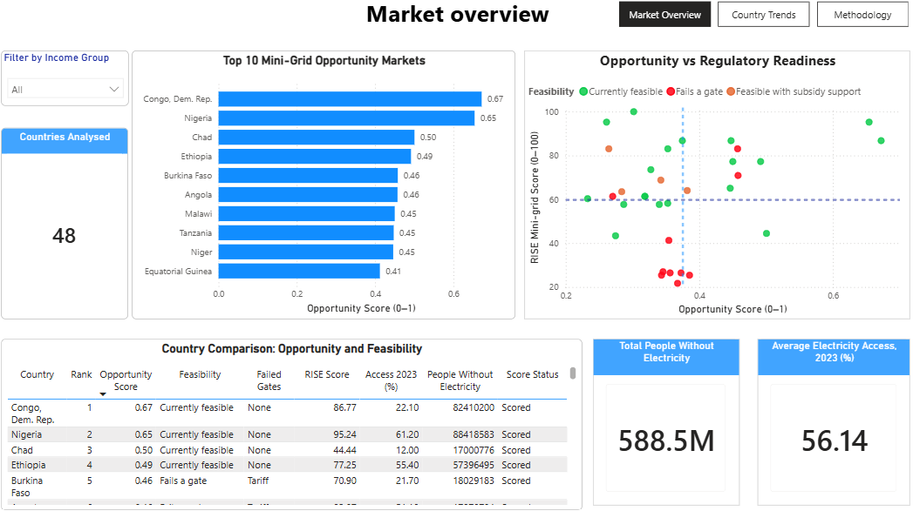
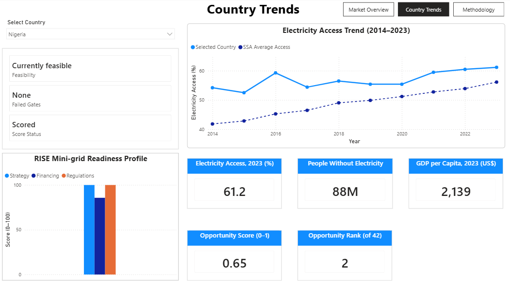
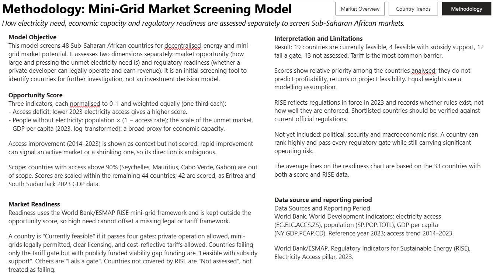

# Energy Market Intelligence for Sub-Saharan Africa

## Project Overview

This project screens Sub-Saharan African countries for decentralized-energy and mini-grid market opportunities, from the perspective of a regional developer considering cross-border expansion.

It assesses two dimensions separately:

* **Market opportunity:** how large and pressing the unmet electricity need is, and whether the economy can support it
* **Regulatory readiness:** whether a private developer can legally operate a mini-grid and earn revenue

Both are built in a reproducible Python pipeline from World Bank and World Bank/ESMAP RISE data, and presented in an interactive Power BI dashboard.

The model identifies countries that warrant further investigation. It is not a substitute for commercial, regulatory, or project-level due diligence.

---

## Business Question

Which Sub-Saharan African countries combine substantial unmet electricity demand with sufficient economic capacity and an enabling regulatory environment for private mini-grid investment?

---

## Key Findings (Version 4)

* **A large access gap does not make a market investable on its own.** Of the 35 countries assessed by RISE, only **19 pass all four regulatory gates** (private operation, legal status, licensing, cost-reflective tariffs).
* **Tariff rules are the most common barrier.** Every country scoring above 60/100 on the RISE mini-grid framework that fails a gate fails on tariffs. Angola and Senegal both score 83/100 overall, yet neither allows cost-reflective tariffs.
* **Four tariff-constrained countries remain workable through subsidy.** Senegal, Sierra Leone, Mozambique, and Togo provide publicly funded viability gap funding and are classified as *feasible with subsidy support*.
* **DR Congo and Nigeria lead on both dimensions:** the two highest opportunity scores, combined with strong RISE readiness (87 and 95 out of 100).
* **High opportunity does not imply feasibility.** Burkina Faso and Angola rank 5th and 6th on opportunity but fail the tariff gate without viability gap funding.
* The 48 countries analysed have an estimated **588 million people without electricity** (2023).

---

## Project Development

The project was built iteratively. Each version answers a narrower question than the one before, and earlier versions are kept for comparison.

### Version 1: Electricity-Access Priority Model

Identified countries with the greatest electricity-access challenge, using access rates (2014–2023), access improvement, and estimated population without electricity, combined into a normalized priority score with sensitivity testing.

### Version 2: Investment Opportunity Model

Added GDP per capita (log-transformed) as a proxy for economic capacity, using four equally weighted components:

$$
\begin{aligned}
\text{Investment Opportunity Score} ={}&
0.25(\text{Access Score}) \\
&+ 0.25(\text{Improvement Score}) \\
&+ 0.25(\text{Population Score}) \\
&+ 0.25(\text{GDP Score})
\end{aligned}
$$

A three-page Power BI dashboard was built on this model ([v2 dashboard](dashboard/energy_investment_dashboard_v2.pbix)).

### Version 3: Variable Screening

Tested additional indicators for household purchasing capacity and productive electricity demand. A scored indicator had to have a credible 2023 value for at least 90% of the 48 countries, including Nigeria.

| Candidate indicator | Decision | Reason |
|---|---|---|
| Household consumption per capita (constant 2015 US$) | Rejected | 42/48 coverage; no data for Nigeria |
| Household consumption per capita (PPP) | Rejected | 43/48 coverage; no data for Nigeria |
| Poverty headcount ratio | Rejected | Latest observations range from 2011 to 2024; only 33/48 from 2018 onward |
| Industry value added (% of GDP) | Rejected | Driven by extractive economies, not productive electricity demand |
| Electric power consumption per capita | Rejected | 32/48 coverage |

Version 3 also reclassified **access improvement** as a contextual indicator rather than a scored one: rapid improvement can signal an active market or a shrinking one, so its direction is ambiguous.

### Version 4: Market Readiness Model (current)

Added regulatory readiness as a separate dimension and revised the opportunity score.

**Opportunity score.** Three equally weighted components, each normalized to 0–1:

$$
\text{Opportunity Score} = \tfrac{1}{3}(\text{Access Score}) + \tfrac{1}{3}(\text{Population Score}) + \tfrac{1}{3}(\text{GDP Score})
$$

* Countries with electricity access above 90% (Seychelles, Mauritius, Cabo Verde, Gabon) are **out of scope** for a mini-grid screen. Scores are scaled within the remaining 44 countries.
* 42 countries are scored; Eritrea and South Sudan are **not scored** because 2023 GDP data are unavailable.
* Every blank score carries an explicit status rather than an unexplained missing value.

**Regulatory readiness.** Based on the 2023 World Bank/ESMAP RISE Minigrids Framework, using country-level answers to specific RISE questions:

| Category | Rule |
|---|---|
| Currently feasible | Private operation allowed, mini-grids legally permitted, clear licensing, and cost-reflective tariffs allowed |
| Feasible with subsidy support | Passes the first three gates; tariffs not cost-reflective; publicly funded viability gap funding available |
| Fails a gate | At least one gate not met |
| Not assessed | Country not covered by RISE |

Readiness is deliberately **kept outside the opportunity score**:

1. RISE covers 35 of 48 countries, below the 90% coverage rule from Version 3.
2. The 13 uncovered countries are mostly small or high-access economies; filling their values would invent data.
3. A weighted sum would let high electricity need offset a missing legal or tariff framework. Readiness works as a gate, not a trade-off.

Result: **19** currently feasible, **4** feasible with subsidy support, **12** fail a gate, **13** not assessed.

---

## Power BI Dashboard (Version 4)

### 1. Market Overview

* Top 10 opportunity markets (in scope)
* **Opportunity vs regulatory readiness** scatter, colored by feasibility, with average lines dividing the chart into quadrants
* Country comparison table with opportunity rank, feasibility, failed gates, and score status
* Income-group filter and regional summary cards



### 2. Country Trends

For a selected country:

* Electricity-access trend (2014–2023) against the Sub-Saharan African average
* Feasibility, failed gates, and score status
* RISE readiness profile (strategy, financing, regulations)
* Access, population without electricity, GDP per capita, opportunity score, and rank



### 3. Methodology

Documents the objective, both dimensions, scope rule, feasibility categories, limitations, and data sources.



[Download the Version 4 Power BI dashboard](dashboard/energy_investment_dashboard_v4.pbix)

---

## Data Sources

**World Bank, World Development Indicators**

* Access to electricity (% of population): `EG.ELC.ACCS.ZS`
* Population, total: `SP.POP.TOTL`
* GDP per capita (current US$): `NY.GDP.PCAP.CD`

**World Bank/ESMAP, Regulatory Indicators for Sustainable Energy (RISE)**

* Electricity Access pillar, 2023: Minigrids Framework scores and question-level responses

Reference year: 2023. Access trend: 2014–2023.

People without electricity is estimated as:

$$
\begin{aligned}
\text{People Without Electricity}
&= \text{Population} \times
\left(
1 - \frac{\text{Electricity Access Rate}}{100}
\right)
\end{aligned}
$$

---

## Limitations

* Scores show relative priority among the countries analysed; they do not predict profitability, returns, or project feasibility.
* Equal weights are a modelling assumption, not empirically estimated.
* GDP per capita is a broad proxy. It lifts resource-rich economies such as Equatorial Guinea without reflecting household purchasing power.
* Estimates show unmet access, not addressable or paying demand.
* RISE records whether regulations exist as of 2023, not how well they are enforced. Shortlisted countries should be verified against current official regulations.
* **Political, security, and macroeconomic risk are not yet included.** A country can rank highly and pass every regulatory gate while carrying significant operating risk.

---

## Next Steps

* Add a risk dimension (political stability, inflation, and currency volatility)
* Use the RISE time series (2010–2023) to measure readiness trends
* Verify current regulations for shortlisted countries

---

## Tools and Technologies

* Python (pandas, NumPy, Matplotlib)
* Jupyter Notebook
* Power BI (Power Query, DAX)
* Git and GitHub

---

## Repository Structure

```text
energy-market-intelligence/
├── dashboard/
│   ├── energy_investment_dashboard_v2.pbix
│   ├── energy_investment_dashboard_v4.pbix
│   └── screenshots/
├── data/
│   ├── raw/
│   │   └── market readiness/          # RISE data
│   └── processed/
│       ├── ssa_electricity_clean_with_priority_score.csv   # v1
│       ├── ssa_investment_opportunity_v2.csv               # v2
│       └── ssa_market_readiness_v4.csv                     # v4
├── docs/
│   └── DATA_DICTIONARY.md
├── notebooks/
│   ├── 01_ssa_electricity_priority_analysis.ipynb
│   ├── 02_investment_model.ipynb
│   ├── 03_market_readiness_model.ipynb   # v3 variable screening
│   └── 04_market_readiness.ipynb         # v4 market readiness
├── src/
│   ├── clean_data.py
│   ├── load_data.py
│   ├── pipeline.py
│   ├── scoring.py
│   ├── utils.py
│   └── visualization.py
├── requirements.txt
└── README.md
```